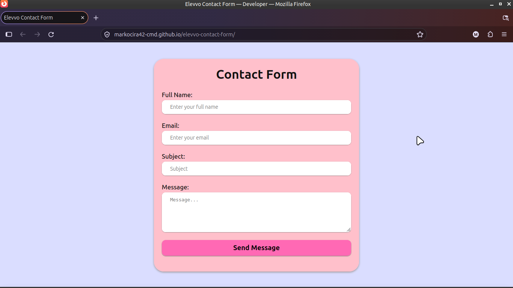
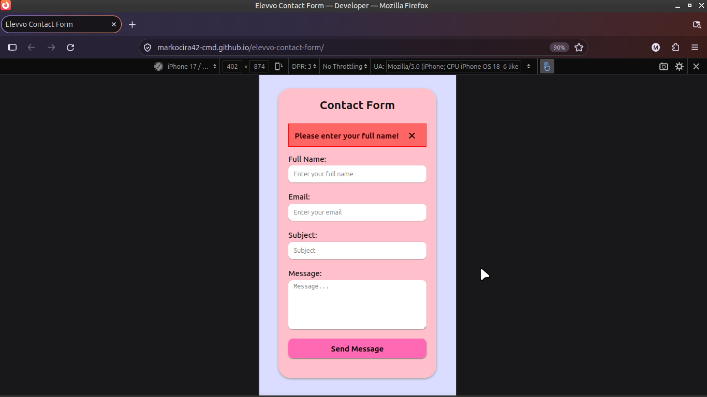

# Elevvo Task 2: Contact Form

A fully responsive, accessible contact form built from scratch using HTML5, CSS3, and Vanilla JavaScript. 

## Live Demo
[View the live form here](https://markocira42-cmd.github.io/elevvo-contact-form/)

## Key Features
- **Client-Side Validation:** Robust JavaScript logic checks for empty fields (ignoring whitespace) and validates email formats natively.
- **Accessibility First:** All inputs are explicitly linked to `<label>` elements using the `for` attribute. Uses `novalidate` on the form to allow custom JS error handling while keeping HTML semantic.
- **Custom UX Feedback:** Features custom, dismissible error and success alert divs. Includes a `flashHighlight` function that briefly outlines invalid fields in red to guide the user.
- **Responsive Design:** Mobile-first approach utilizing CSS Flexbox and `clamp()` for fluid typography.

## Tech Stack
- **HTML5:** Semantic markup and native form validation attributes.
- **CSS3:** Custom properties, Flexbox, media queries, and transitions.
- **Vanilla JavaScript (ES6+):** DOM manipulation and Event Listeners.

## Screenshots

### Desktop View

### Mobile View & Error State

